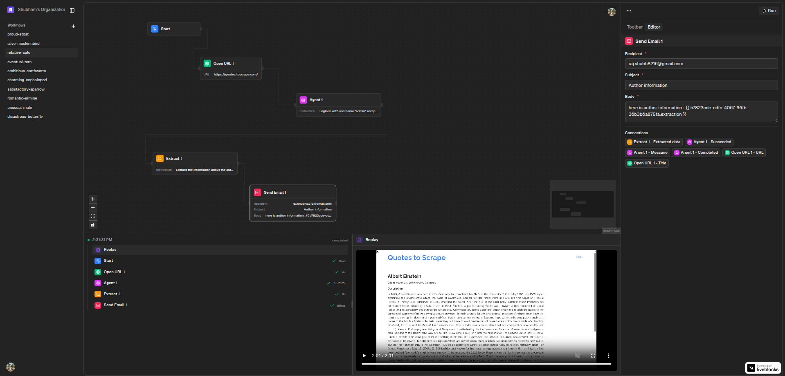

# AgentSurf

AgentSurf is a visual browser-automation platform for building, running, and observing AI-powered workflows. Create a workflow on a node-based canvas, connect browser and communication steps, and run the graph as a durable background task.

The project combines [Stagehand](https://docs.stagehand.dev/) and [Browserbase](https://www.browserbase.com/) for browser automation, [Trigger.dev](https://trigger.dev/) for durable execution, and [Liveblocks](https://liveblocks.io/) for collaborative editing.



## Links

- [Live application](https://agent-surf.vercel.app/)
- [Source code on GitHub](https://github.com/shubhamraj82/AgentSurf)
- [Stagehand documentation](https://docs.stagehand.dev/)
- [Browserbase documentation](https://docs.browserbase.com/)
- [Trigger.dev documentation](https://trigger.dev/docs)
- [Liveblocks documentation](https://liveblocks.io/docs)
- [Clerk documentation](https://clerk.com/docs)
- [Neon documentation](https://neon.tech/docs)

## Features

- Visual workflow editor powered by React Flow.
- Organization-aware authentication with Clerk.
- Real-time workflow-room collaboration with Liveblocks, including shared edits and live cursors labeled with each collaborator&apos;s name.
- Invited organization members can access the same workflow room and see canvas changes as they happen.
- Browser automation through Browserbase and Stagehand.
- Durable, retryable workflow execution with Trigger.dev.
- Live run status, logs, step durations, outputs, and errors.
- A replay entry for completed runs that shows what the browser session actually did while the workflow nodes executed.
- Browser session replay for Pro-plan users through an authenticated server-side proxy.
- Variable interpolation between node outputs and downstream node inputs.
- Workflow graph validation and topological execution ordering.
- Email delivery through Resend.
- Pro-plan gating for Agent nodes and session replay.
- Error monitoring and structured logging with Sentry.
- Dark-mode-ready UI built with Tailwind CSS and shadcn/ui components.

## Workflow building blocks

Every workflow starts with a `Start` trigger and can contain the following action nodes:

| Node | Purpose |
| --- | --- |
| `Open URL` | Navigate the active browser page to a validated HTTP/HTTPS URL. |
| `Observe` | Find possible browser actions and return selectors and descriptions. |
| `Act` | Execute a focused natural-language browser action. |
| `Agent` | Execute a higher-level Stagehand agent instruction. Available on the Pro plan. |
| `Extract` | Extract structured information from the active page. |
| `Send Email` | Send an HTML email using Resend. |

Node outputs can be referenced by later nodes using interpolation, for example `{{open-url.url}}` or `{{extract.extraction}}`.

## How a workflow runs

```text
User edits canvas
        |
        v
Server Action validates and saves the graph
        |
        v
Trigger.dev starts the run-workflow task
        |
        v
Graph is topologically sorted and nodes run in order
        |
        v
One Browserbase session is reused across browser nodes
        |
        v
Step metadata, logs, outputs, and errors stream to the UI
        |
        v
Session replay is proxied through the application API
```

## Architecture

### Frontend

The Next.js App Router renders the authenticated dashboard and workflow editor. The workflow canvas uses React Flow, while Liveblocks provides room state and collaboration. The right sidebar exposes node configuration, graph validation, run controls, logs, and replay UI.

### Authentication and tenancy

Clerk handles sign-in, sign-up, organization selection, and plan checks. Every workflow is stored with an `orgId`, and server actions verify the active organization before reading or changing data.

### Real-time collaboration

Workflow pages are backed by a Liveblocks room scoped to the workflow. Members invited to the organization can enter that room and collaboratively edit the same React Flow canvas. Changes are synchronized in real time, and Liveblocks&apos; React Flow integration renders each collaborator&apos;s live cursor with their resolved display name, making it clear who is working in the room.

### Persistence

Workflow records are stored in PostgreSQL through Neon and Drizzle ORM. The graph is persisted as JSONB containing React Flow nodes and edges. Database migrations are kept in the `drizzle/` directory.

### Execution

The `run-workflow` Trigger.dev task loads a workflow, validates its graph, sorts connected nodes with `toposort`, and invokes the matching executor from the node registry. Browser nodes lazily create one Browserbase/Stagehand session and reuse it for the entire run. Trigger metadata powers the live run view.

The run console lists each executed node with its status, duration, and outputs. After a completed browser run, the `Replay` entry opens the session replay beside the run details, so users can inspect what the browser actually performed—not only what the workflow graph was configured to do.

### Observability

Sentry is configured for Next.js server, edge, client, and Trigger.dev build instrumentation. Browserbase session replay is fetched server-side and served to the client as an HLS playlist through `/api/replays/[sessionId]`.

## Tech stack

| Area | Technologies |
| --- | --- |
| Framework | Next.js `16.2.6`, React `19.2.4`, TypeScript |
| Styling | Tailwind CSS `4`, shadcn/ui, Radix UI, `tw-animate-css` |
| Canvas | `@xyflow/react`, `@liveblocks/react-flow` |
| Authentication | Clerk (`@clerk/nextjs`) |
| Collaboration | Liveblocks client, React, Node, and UI packages |
| Browser automation | Browserbase SDK, Stagehand `3.7.1` |
| Background jobs | Trigger.dev SDK and React hooks |
| Database | Neon serverless PostgreSQL, Drizzle ORM, Drizzle Kit |
| Email | Resend |
| Monitoring | Sentry for Next.js, Node, and build instrumentation |
| UI utilities | Lucide React, Sonner, Recharts, HLS.js, date-fns, pretty-ms |
| Validation and graph utilities | Zod, topological sort, class-variance-authority, clsx |

## Requirements

- Node.js 20 or newer
- npm
- A Clerk application with organizations enabled
- A Neon PostgreSQL database
- A Liveblocks secret key
- A Trigger.dev project and secret key
- Browserbase API access
- A model configuration supported by Stagehand/Browserbase
- A Resend API key if using `Send Email`
- Sentry credentials if deploying with source-map upload and monitoring

## Getting started

1. Clone the repository and enter the project directory:

   ```bash
   git clone https://github.com/shubhamraj82/AgentSurf.git
   cd AgentSurf
   ```

2. Install dependencies:

   ```bash
   npm install
   ```

3. Create a local environment file:

   ```bash
   cp .env.example .env.local
   ```

4. Add the credentials listed below to `.env.local`.

5. Generate and apply the database schema:

   ```bash
   npm run db:push
   ```

   For migration-based environments, use `npm run db:generate` and `npm run db:migrate` instead.

6. Start the Next.js development server:

   ```bash
   npm run dev
   ```

7. Start the Trigger.dev local development worker in a second terminal:

   ```bash
   npx trigger.dev@latest dev
   ```

8. Open [http://localhost:3000](http://localhost:3000), authenticate with Clerk, select an organization, create a workflow, and run it.

## Environment variables

The application reads these variable names:

| Variable | Used for | Required |
| --- | --- | --- |
| `DATABASE_URL` | Runtime Neon database connection | Yes |
| `DATABASE_URL_UNPOOLED` | Drizzle Kit migrations and schema commands | Yes |
| `NEXT_PUBLIC_CLERK_PUBLISHABLE_KEY` | Clerk client configuration | Yes |
| `CLERK_SECRET_KEY` | Clerk server authentication | Yes |
| `LIVEBLOCKS_SECRET_KEY` | Liveblocks server authentication | Yes |
| `TRIGGER_SECRET_KEY` | Trigger.dev task execution | Yes |
| `BROWSERBASE_API_KEY` | Browser sessions and session replay | Yes for browser workflows |
| `RESEND_API_KEY` | `Send Email` node | Yes when sending email |
| `SENTRY_DSN` | Server and edge error monitoring | Recommended |
| `NEXT_PUBLIC_SENTRY_DSN` | Client error monitoring | Recommended |
| `SENTRY_ORG` | Sentry build integration | Recommended for deployment |
| `SENTRY_PROJECT` | Sentry build integration | Recommended for deployment |
| `SENTRY_AUTH_TOKEN` | Sentry source-map upload | Recommended for deployment |

Use credentials from the relevant provider dashboards. Do not commit `.env.local` or expose server-only secrets to the browser.

## Useful commands

| Command | Description |
| --- | --- |
| `npm run dev` | Start the Next.js development server. |
| `npm run build` | Create a production build. |
| `npm run start` | Start the production server after building. |
| `npm run lint` | Run ESLint. |
| `npm run typecheck` | Run TypeScript without emitting files. |
| `npm run format` | Format TypeScript and TSX files with Prettier. |
| `npm run db:generate` | Generate a Drizzle migration from schema changes. |
| `npm run db:migrate` | Apply Drizzle migrations. |
| `npm run db:push` | Push the current schema directly to the database. |
| `npm run db:studio` | Open Drizzle Studio. |

## Project structure

```text
app/                         Next.js routes, layouts, auth pages, and API routes
components/                  Shared application and shadcn/ui components
features/workflows/          Workflow data, actions, canvas, nodes, and tasks
  components/                Canvas, inspector, logs, replay, and run UI
  nodes/                     Node definitions and node executor implementations
  tasks/                     Trigger.dev background tasks
  lib/                       Graph validation, interpolation, and URL helpers
lib/db/                      Drizzle database client and schema
drizzle/                     Generated database migrations
proxy.ts                     Clerk middleware
trigger.config.ts            Trigger.dev project and build configuration
instrumentation*.ts          Sentry instrumentation
```

## Adding a workflow node

Add a node in `features/workflows/nodes` using the existing three-part pattern:

1. Add the executor implementation, such as `open-url.ts`.
2. Register the executor in `node-executer.ts`.
3. Add the node manifest to `node-registry.ts`, including its type, label, icon, fields, accent, and outputs.

The canvas and run task are registry-driven, so they should not need separate node-specific edits.

## Validation before opening a pull request

```bash
npm run lint
npm run typecheck
npm run build
```

When changing the database schema, also generate and review the resulting migration before applying it.

## License

No license file is currently included in the repository. Add a license before distributing AgentSurf as open-source software.
